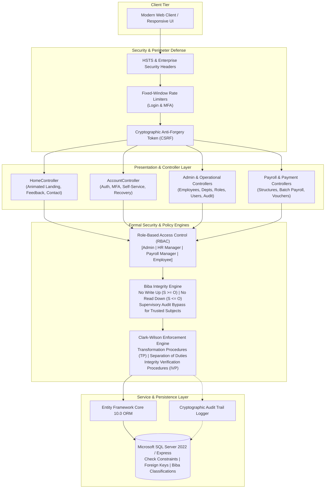

# 🛡️ Secure Employee Payroll Management System (SEPS)

[](https://dotnet.microsoft.com/)
[](https://learn.microsoft.com/en-us/dotnet/csharp/)
[](https://www.microsoft.com/en-us/sql-server)
[](#-biba-strict-integrity-model)
[](#-clark-wilson-commercial-integrity-model)
[](#-automated-testing--verification-suite)
[](#-automated-testing--verification-suite)
[](LICENSE)
[](#)

---

## 📖 Executive Summary

The **Secure Employee Payroll Management System (SEPS)** is an enterprise-grade, defense-in-depth workforce management and automated compensation processing platform built with **ASP.NET Core 10.0**, **Entity Framework Core**, and **Microsoft SQL Server**. 

Unlike conventional business management systems that rely exclusively on discretionary or basic role-based access control, SEPS enforces **formal mathematical integrity models**:
1. **The Biba Strict Integrity Model** — mathematically preventing lower-integrity pollution into critical payroll records and high-integrity supervisory tiers.
2. **The Clark-Wilson Commercial Integrity Model** — guaranteeing financial ledger correctness through Constrained Data Items (CDIs), Transformation Procedures (TPs), Integrity Verification Procedures (IVPs), and strict Separation of Duties (SOD).

Combined with **PBKDF2-HMAC-SHA256** credential protection, **multi-factor authentication (MFA via TOTP & Email OTP)**, **cryptographic anti-tamper token architectures**, **brute-force lockout throttles**, and **strict defense against CSV formula injection**, SEPS represents a battle-tested reference implementation for high-consequence payroll and HR ecosystems.

---

## 🏛️ System Architecture



---

## 🔐 Formal Security Architecture

### 1. Biba Strict Integrity Model

SEPS establishes four hierarchical integrity classifications:

$$\text{Untrusted (1)} < \text{SlightlyTrusted (2)} < \text{Trusted (3)} < \text{HighlyTrusted (4)}$$

| Classification Level | Typical Subjects (Actors) | Protected Objects (Entities) |
| :--- | :--- | :--- |
| **HighlyTrusted (4)** | System Administrator (`Admin`) | System Configuration, User Credentials, Role Grants, Audit Logs |
| **Trusted (3)** | `HR Manager`, `Payroll Manager` | Approved Payroll Runs, Payment Vouchers, Salary Structures, Department Catalog |
| **SlightlyTrusted (2)** | Standard `Employee`, Unverified Users | Attendance Clockings, Leave Applications, Employee Self-Profiles |
| **Untrusted (1)** | Anonymous Visitors, External Input | Raw Public Inquiries, Guest Feedback Submissions, Contact Messages |

#### Formal Mathematical Axioms Enforced:
1. **Simple Integrity Axiom ("No Read Down")**:
   $$L(S) \le L(O)$$
   *A subject at a higher integrity level cannot read data from a lower integrity level without sanitization, preventing corrupt or poisoned data from influencing high-integrity state machines.*
   > **Enterprise Supervisory Provision**: Authorized administrators ($S = 4$) and managers ($S = 3$) have legitimate read access to operational records ($O \ge \text{SlightlyTrusted}$) for inspection and auditing, while untrusted inputs ($O = \text{Untrusted}$) remain strictly partitioned.
2. **Star Integrity Axiom ($\star$-Property - "No Write Up")**:
   $$L(S) \ge L(O)$$
   *A subject at a lower integrity level cannot write to or modify an object at a higher integrity level. Employees ($L=2$) can never directly alter salary scales ($L=3$) or user roles ($L=4$).*

---

### 2. Clark-Wilson Commercial Integrity Model

Designed explicitly for commercial financial computing, the Clark-Wilson model ensures that system state is maintained exclusively in valid configurations:
- **Constrained Data Items (CDIs)**: Highly sensitive business data whose integrity is protected (e.g., `PAYROLL`, `PAYMENT`, `SALARY_STRUCTURE`).
- **Unconstrained Data Items (UDIs)**: Unvalidated inputs, such as raw HTTP form data or public contact messages.
- **Transformation Procedures (TPs)**: Certified, audited transaction routines that validate UDIs and transform them into valid CDIs through atomic transitions.
- **Integrity Verification Procedures (IVPs)**: Automated validation procedures confirming that all CDIs conform to internal accounting consistency rules (e.g., verifying Gross Pay - Total Deductions = Net Pay).
- **Separation of Duties (SOD)**: Mandatory multi-party integrity checks:
  - An actor who creates a payroll run **cannot approve their own disbursement voucher**.
  - Duplicate approvals on already finalized financial transactions are strictly blocked at the transaction engine level.

---

### 3. Cryptographic & Application Security

- **Password Storage**: Uses `Rfc2898DeriveBytes` PBKDF2 with HMAC-SHA256, 100,000 iterations, and a unique 128-bit cryptographic salt per account.
- **Multi-Factor Authentication (MFA)**:
  - **TOTP (RFC 6238)**: Time-based one-time password generation compatible with Google Authenticator, Microsoft Authenticator, and 1Password.
  - **Email OTP**: Cryptographically generated 6-digit one-time passcodes with short expiration windows.
  - **Single-Use Emergency Recovery Codes**: Pre-generated cryptographic emergency codes for account recovery.
- **Brute-Force & Account Lockout Defense**:
  - Incremental tracking of consecutive failed authentication attempts.
  - Automatic 30-second lockout on the 5th consecutive failure, preventing high-speed credential stuffing.
  - Account lockout counter resets to zero upon successful authenticated login.
- **Enterprise Security Headers**:
  - `X-Content-Type-Options: nosniff`
  - `X-Frame-Options: SAMEORIGIN`
  - `Referrer-Policy: strict-origin-when-cross-origin`
  - `Permissions-Policy: camera=(), microphone=(), geolocation=()`
- **Anti-Forgery (CSRF)**: All state-changing POST/PUT actions require cryptographically validated `__RequestVerificationToken` tokens.
- **CSV Formula Injection Mitigation**: Dynamic exports sanitize formula triggers (`=`, `+`, `-`, `@`, `\t`, `\r`) by prepending single quotes to protect Microsoft Excel and LibreOffice users.

---

## 👥 Role-Based Access Control (RBAC) Matrix

| Capability / Section | Admin (`tanuj.garg`) | HR Manager (`riya.sharma`) | Payroll Manager (`vikram.singh`) | Employee (`kabir.verma`) |
| :--- | :---: | :---: | :---: | :---: |
| **Organizational Dashboard** | Full Operational Metrics | HR Metrics | Payroll Metrics | Personal Self-Service |
| **Employee Directory** | Full View / Edit | Full CRUD | View Only | View Self Only |
| **Departments & Designations** | Full CRUD | Full CRUD | View Only | View Only |
| **Attendance Tracking** | System-Wide Audit | Team Overview | View Summary | Clock In / Clock Out |
| **Leave Management** | Oversight & Approvals | Full Approval Queue | View Approved | Submit Applications |
| **Salary Grading & Structures** | System Governance | View Only | Full CRUD | Prohibited (403) |
| **Batch Payroll Execution** | System Governance | Prohibited (403) | Generate & Approve | View Personal Slips |
| **Disbursement Vouchers** | Audit & Verification | Prohibited (403) | Record & Disburse | Prohibited (403) |
| **Biba & Clark-Wilson Audits** | Full Access | Prohibited (403) | Prohibited (403) | Prohibited (403) |
| **User & Role Administration** | Full CRUD | Prohibited (403) | Prohibited (403) | Prohibited (403) |
| **System Settings & Backups** | Full Access | Prohibited (403) | Prohibited (403) | Prohibited (403) |

---

## 🔑 Pre-Configured Test Credentials

| Username | Role | Full Name | Email | Password | Default MFA |
| :--- | :--- | :--- | :--- | :--- | :---: |
| `tanuj.garg` | **Admin** | Tanuj Garg | `tanujgarg187@gmail.com` | `Admin@123` | Enabled (TOTP / Email) |
| `riya.sharma` | **HR Manager** | Riya Sharma | `riya.sharma@example.com` | `Hr@123` | Disabled |
| `vikram.singh` | **Payroll Manager** | Vikram Singh | `vikram.singh@example.com` | `Payroll@123` | Disabled |
| `kabir.verma` | **Employee** | Kabir Verma | `kabir.verma@example.com` | `Emp@123` | Disabled |

---

## ✨ Features & Interface Showcase

### 1. Interactive Landing Page
- **Animated Hero Section**: Staggered typography reveals, floating backdrop shapes, and gradient glow accents.
- **10-Entry Interactive Testimonial Carousel**: Touch-ready feedback slider with automatic pagination, pause-on-hover, and live visitor feedback submission.
- **Enterprise Contact & Inquiry Form**: Fully validated CSRF-protected communication portal.

### 2. Operational Dashboards
- **High-DPI Metric Cards**: Real-time employee headcount, monthly payroll expenditure, pending leave counters, and daily attendance percentages.
- **Responsive Layout**: Designed for seamless accessibility across desktops, laptops, tablets, and mobile devices.

### 3. Payroll & Disbursement Engine
- **Salary Components**: Configurable allowances (HRA, DA, Special) and deductions (PF, Tax, ESI).
- **One-Click Batch Processing**: Automatic calculation of working days, loss-of-pay deductions, and net salary.
- **Printable Payslips**: High-resolution, print-ready CSS payslips with breakdown tables and company letterhead styling.
- **Payment Vouchers**: Supports Bank Transfer, Cheque, and Cash disbursements with verified check constraints (`CK_PAYMENT_METHOD`, `CK_PAYMENT_STATUS`).

---

## 🚀 Setup & Execution Guide

### Prerequisites
- [.NET 10.0 SDK](https://dotnet.microsoft.com/download/dotnet/10.0)
- [Microsoft SQL Server](https://www.microsoft.com/en-us/sql-server) (2019, 2022, or SQL Server Express)
- Windows PowerShell 5.1 or PowerShell Core 7+

### 1. Clone the Repository
```bash
git clone https://github.com/Gargtanuj-git/SecureEmployeePayrollManagementSystem.git
cd SecureEmployeePayrollManagementSystem
```

### 2. Configure Database Connection
Review `SecureEmployeePayrollSystem/appsettings.json` and adjust the connection string to target your local SQL Server instance:
```json
{
  "ConnectionStrings": {
    "DefaultConnection": "Server=localhost\\SQLEXPRESS;Database=SecureEmployeePayrollDB;Trusted_Connection=True;TrustServerCertificate=True;MultipleActiveResultSets=True"
  }
}
```

### 3. Database Migrations & Schemas
The database schema, stored procedures, check constraints, and Biba/Clark-Wilson models are provisioned in SQL scripts:
- `SecureEmployeePayrollSystem/Data/Biba_Integrity_Migration.sql`
- `SecureEmployeePayrollSystem/Data/ClarkWilson_Migration.sql`

Run these scripts via SQL Server Management Studio (SSMS) or `sqlcmd`:
```powershell
sqlcmd -S .\SQLEXPRESS -d SecureEmployeePayrollDB -i .\SecureEmployeePayrollSystem\Data\Biba_Integrity_Migration.sql
sqlcmd -S .\SQLEXPRESS -d SecureEmployeePayrollDB -i .\SecureEmployeePayrollSystem\Data\ClarkWilson_Migration.sql
```

### 4. Build and Code-Sign Assemblies
To ensure compliance with Windows Code Integrity and Smart App Control policies, SEPS includes an automated code-signing utility:
```powershell
# Step A: Build the complete solution
dotnet build .\SecureEmployeePayrollSystem.slnx

# Step B: Automatically sign compiled binaries using development certificate
powershell -ExecutionPolicy Bypass -File .\sign.ps1
```

### 5. Launch the Application
```powershell
dotnet run --project .\SecureEmployeePayrollSystem\SecureEmployeePayrollSystem.csproj --no-build
```

Navigate to:
- **Local Web Interface**: `http://localhost:5039`

---

## 🧪 Automated Testing & Verification Suite

SEPS includes a dedicated automated test project covering unit, cryptographic, integrity, and functional regression tests:

```powershell
# Execute the complete automated security test suite
dotnet run --project .\SecureEmployeePayrollSystem.Tests\SecureEmployeePayrollSystem.Tests.csproj --no-build
```

### Test Suite Execution Summary (62 / 62 Passing):
```text
====================================================
RUNNING SEPS AUTOMATED TEST SUITE (PHASE 5 SECURITY)
====================================================
[PASS] Test 1: Admin login authenticated with role Admin.
[PASS] Test 2: HR Manager login authenticated with role HR Manager.
[PASS] Test 3: Payroll Manager login authenticated with role Payroll Manager.
[PASS] Test 4: Employee login authenticated with role Employee.
[PASS] Test 5: Invalid password correctly rejected.
[PASS] Test 6: DepartmentService retrieved departments from SQL Server.
[PASS] Test 7: EmployeeService retrieved employee records.
[PASS] Test 8: AttendanceService today's summary retrieved.
[PASS] Test 9: LeaveService correctly prevented overlapping leave application.
[PASS] Test 10: ReportService sanitized malicious CSV injection formula.
[PASS] Test 11: DashboardService loaded system metrics.

--- PHASE 5 BRUTE-FORCE & INPUT VALIDATION TESTS ---
[PASS] Tests 12-21: Brute-force incremental lockouts, 30-second backoffs, and whitespace preservation.

--- PHASE 6 EMAIL & TOKEN RECOVERY TESTS ---
[PASS] Tests 22-37: Password resets, anti-tamper verification tokens, single-use burn cycles, and view validation.

--- BIBA INTEGRITY MODEL TESTS (GROUPS A, B, C, D) ---
[PASS] Test 38: Group A - Biba No Read Down (S <= O) verified across all 16 integrity permutations.
[PASS] Test 39: Group B - Biba No Write Up (S >= O) verified across all 16 integrity permutations.
[PASS] Tests 40-49: Object promotion workflows, classification mapping, and defense-in-depth demotion blocking.

--- CLARK-WILSON INTEGRITY MODEL TESTS (TESTS A - M) ---
[PASS] Tests 50-62: Transformation Procedures, Separation of Duties, duplicate prevention, and atomic rollbacks.

====================================================
FINAL TEST SUMMARY: 62 PASSED, 0 FAILED.
====================================================
```

---

## 📂 Project Structure

```text
SecureEmployeePayrollManagementSystem/
│
├── .gitignore                                 # Clean Git ignore rules (bin, obj, logs excluded)
├── README.md                                  # Enterprise documentation and system guide
├── SecureEmployeePayrollSystem.slnx           # Modern XML solution file (.NET 10)
├── sign.ps1                                   # PowerShell Code Integrity signing automation
│
├── SecureEmployeePayrollSystem/               # Core ASP.NET Core 10.0 MVC Application
│   ├── Controllers/                           # Web Controllers (Account, Employees, Payroll, etc.)
│   ├── Data/                                  # DbContext, SQL Migration scripts, Configurations
│   ├── Models/                                # Entity Framework Core models & Domain entities
│   ├── Services/                              # Business Logic, Biba Model, Clark-Wilson TPs, MFA
│   ├── ViewModels/                            # Strongly-typed presentation view models
│   ├── Views/                                 # Razor Views with modern animated styling
│   └── wwwroot/                               # Static assets (CSS, JS, Fonts, Images)
│
└── SecureEmployeePayrollSystem.Tests/         # Comprehensive Security & Functional Test Suite
    ├── Program.cs                             # 62-test automated verification harness
    └── SecureEmployeePayrollSystem.Tests.csproj
```

---

## 📄 License & Attribution

This project is licensed under the **MIT License** — see the [LICENSE](LICENSE) file for full details.

**Author & System Architect**: **Tanuj Garg**  
**Repository**: [Gargtanuj-git/SecureEmployeePayrollManagementSystem](https://github.com/Gargtanuj-git/SecureEmployeePayrollManagementSystem)
